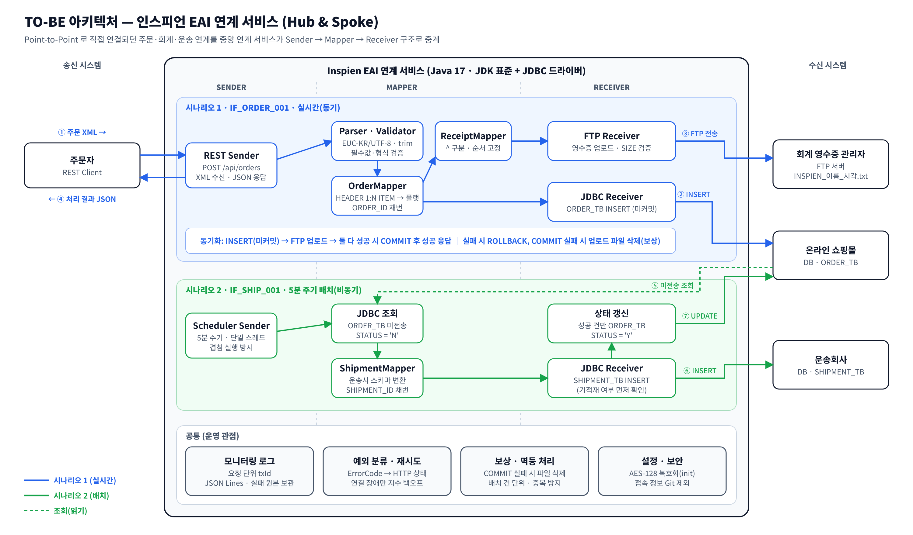

# 인스피언 EAI 과제 — 주문·회계·운송 연계 서비스

온라인 쇼핑몰(토토)의 **주문 → 주문 DB 적재 + 회계 영수증 FTP 전송(실시간)**, **주문 DB → 운송사 DB(5분 배치)** 연계를
EAI 구조(**Sender → Mapper → Receiver**)로 구현했습니다.



## 1. 요구사항 대응

| 과제 요구사항 | 구현 위치 | 내용 |
|---|---|---|
| 4.1 정보 수신·복호화 | `bootstrap/ApplicantInfoClient`, `common/AesDecryptor` | Basic Auth 호출, AES-128/ECB/PKCS5 (키 = SHA-1(전화번호) 앞 16byte), SAMPLE_DATA Base64 → EUC-KR 복원 |
| 3.1 (1) 주문 API (REST Sender) | `sender/RestOrderSender` | `POST /api/orders` XML 수신, 처리 결과 JSON 동기 응답 |
| 3.1 유효성 검증 | `mapper/OrderXmlParser`, `mapper/OrderValidator` | 필수값, PRICE 숫자, 구분자 포함 여부, XXE 차단(위반 시 전체 거부) / HEADER 없는 ITEM 은 해당 건만 제외(PARTIAL) |
| 3.1 (2.1) 플랫 매핑·ORDER_TB 적재 | `mapper/OrderMapper`, `receiver/JdbcOrderReceiver` | HEADER 1:N ITEM → ITEM 1건당 1행, ORDER_ID 채번, APPLICANT_KEY 고정 |
| 3.1 (2.2) 파일 생성·FTP 전송 | `mapper/ReceiptFileMapper`, `receiver/FtpReceiptReceiver` | `INSPIEN_참여자명_yyyyMMddHHmmss.txt`, 필드·순서 고정, 업로드 후 SIZE 검증 |
| 3.1 (3) JDBC·FTP 동기화 | `flow/OrderInterfaceFlow` | INSERT(미커밋) → FTP → COMMIT, 실패 시 ROLLBACK / 보상 삭제 |
| 3.2 운송사 배치 | `sender/ShipmentBatchScheduler`, `flow/ShipmentBatchFlow` | 5분 주기, STATUS='N' 조회 → SHIPMENT_TB 적재 → 성공 건 STATUS='Y' |
| 3.3 (1) 운영 로그 | `common/MonitorLog`, `common/AppLog` | 요청 단위 txId, 단계별 성공/실패 이력 local 파일(JSON Lines) |
| 3.3 (2) 예외 처리 | `common/ErrorCode`, `common/Retry`, 각 Receiver | 오류 분류, 일시 장애만 재시도, 실패 원본 보관 |
| 3.4 아키텍처 | `docs/architecture.png` | 변경된 TO-BE 아키텍처 |

## 2. 실행 방법

**필요 환경**: JDK 17 이상, Maven 3.8 이상 (자체 테스트는 python3 추가)

> **JAVA_HOME 을 JDK 17 이상으로 설정하거나, Windows 에서는 `run.bat` 상단의 `JDK17` / `MVN` 경로를 자기 PC 에 맞게 수정해서 사용합니다.**
> `run.bat build | init ... | check | server | send [xml] | batch | report` 형태로 아래 명령과 동일하게 동작합니다.
>
> 정보 수신 API 인증서의 루트(DigiCert TLS RSA4096 Root G5)는 JDK 17.0.10 부터 기본 신뢰 목록에 포함됩니다.
> 그 이전 JDK 에서 `init` 이 `PKIX path building failed` 로 실패하면 `-Djavax.net.ssl.trustStoreType=Windows-ROOT`
> (Windows 인증서 저장소 사용)를 붙여 실행하거나 JDK 를 업데이트합니다. `run.bat` 에는 이 옵션이 들어 있습니다.

```bash
# 0) 정보 수신 API 접속 정보 준비 (Git 제외 파일)
cp config/recruiting-api.example.properties config/recruiting-api.properties   # username / password 입력

# 1) 빌드
mvn -q package            # target/eai-assignment.jar + target/lib/(JDBC 드라이버)

# 2) 정보 수신 + 접속 정보 복호화 → config/application.properties, config/conn/*.json 생성
java -jar target/eai-assignment.jar init --name 홍길동 --phone 010-1234-5678 --email me@example.com

# 3) DB 2개 / FTP 접속 확인
java -jar target/eai-assignment.jar check

# 4) 연계 서비스 기동 (REST Sender + 5분 배치)
java -jar target/eai-assignment.jar server

# 5) (다른 터미널) 수신한 샘플 주문 전송 → 결과 JSON 확인
java -jar target/eai-assignment.jar send                       # config/received/sample.xml
java -jar target/eai-assignment.jar send my-order.xml          # 임의 XML

# 기타
java -jar target/eai-assignment.jar batch                      # 배치 1회 즉시 실행
java -jar target/eai-assignment.jar report                     # 내 지원자 키 기준 ORDER_TB / SHIPMENT_TB 조회
```

- 모든 명령은 프로젝트 루트에서 실행합니다(`config/`, `logs/` 상대 경로).
- `check` 결과로 실제 DBMS 를 확인한 뒤 `pom.xml` 에서 쓰지 않는 드라이버는 지워도 됩니다.
- 복호화된 접속 정보의 키 이름이 예상과 다르면 `config/application.properties` 에 `order.db.url` 등을 직접 지정합니다.
- Windows 콘솔에서 한글이 깨지면 `chcp 65001` 후 실행합니다.

**curl 로 직접 호출**

```bash
curl -X POST http://localhost:8080/api/orders -H "Content-Type: application/xml; charset=UTF-8" --data-binary @config/received/sample.xml
```

실제 수신한 샘플(HEADER 15건, ITEM 70건)을 보낸 결과입니다. HEADER 가 없는 ITEM 7건은 제외하고 63건을 처리했습니다 (HTTP 200, `result` = `PARTIAL`).
모든 ITEM 이 정상이면 `result` = `SUCCESS`, `code` = `S000` 이고 `skippedItems` 가 없습니다. (`orderIds`, `skippedItems` 는 일부 생략)

```json
{"interfaceId":"IF_ORDER_001","txId":"IF_ORDER_001-20261018174035190-0002","result":"PARTIAL","code":"S001",
 "message":"주문 63건 적재 및 영수증 전송 완료, HEADER 없는 ITEM 7건 제외","orderCount":63,
 "orderIds":["A000","A001","A002", ... ,"A062"],"receiptFile":"INSPIEN_김선혁_20261018174035.txt","skippedCount":7,
 "skippedItems":[{"userId":"USER16","itemId":"ITEM64","reason":"USER_ID(USER16) 에 해당하는 HEADER 가 없습니다."},
                 {"userId":"USER17","itemId":"ITEM65","reason":"USER_ID(USER17) 에 해당하는 HEADER 가 없습니다."}, ...],
 "warnings":["USER_ID(USER14) HEADER 에 ITEM 이 없어 적재 대상에서 제외됩니다.", ...]}
```

**시연용 조회 SQL** (참여자명·당일 기준) — 상태별 건수, 주문자별 합계, 배치 정합성 점검 쿼리는 [`docs/demo.sql`](docs/demo.sql)

```sql
SELECT * FROM ORDER_TB    WHERE APPLICANT_KEY = '<지원자키>' ORDER BY ORDER_ID;
SELECT * FROM SHIPMENT_TB WHERE APPLICANT_KEY = '<지원자키>' ORDER BY SHIPMENT_ID;
-- FTP: INSPIEN_<참여자명>_<오늘날짜>*.txt
```

## 3. 구조

```
src/main/java/com/assignment/eai
├── Main.java                 명령 진입점·조립(wiring)
├── bootstrap/                정보 수신 API 호출 + 복호화 (init)
├── sender/                   들어오는 연결 지점
│   ├── RestOrderSender         HTTP (JDK HttpServer)
│   └── ShipmentBatchScheduler  5분 주기 기동
├── mapper/                   데이터 변환 (프로토콜과 무관한 순수 로직)
│   ├── OrderXmlParser / OrderValidator
│   ├── OrderMapper             HEADER:ITEM → ORDER_TB
│   ├── ReceiptFileMapper       ORDER_TB → 영수증 파일
│   └── ShipmentMapper          ORDER_TB → SHIPMENT_TB
├── receiver/                 나가는 연결 지점 (어댑터)
│   ├── JdbcOrderReceiver / JdbcShipmentReceiver / JdbcSupport
│   └── FtpReceiptReceiver / SimpleFtpClient
├── flow/                     인터페이스 단위 처리 흐름 (트랜잭션·보상·이력)
│   ├── OrderInterfaceFlow      IF_ORDER_001 (실시간)
│   └── ShipmentBatchFlow       IF_SHIP_001  (배치)
├── model/                    메시지·레코드 (record)
└── common/                   설정, 복호화, 채번, JSON, 로그, 예외, 재시도
```

- **Sender / Mapper / Receiver 를 패키지로 분리**해 과제의 인스피언 참고 구조를 그대로 코드에 반영했습니다. Mapper 는 DB·FTP·HTTP 를 모르므로 단독 테스트가 가능하고, 수신 측 프로토콜이 바뀌어도 Receiver 만 교체하면 됩니다.
- **Flow** 는 "어떤 Sender 로 받아 어떤 Mapper 를 거쳐 어떤 Receiver 로 보낼지"와 그 사이의 트랜잭션·보상·로그를 담당합니다(EAI 솔루션의 Integration Flow 에 해당).
- **외부 라이브러리는 JDBC 드라이버만** 사용했습니다. HTTP 서버(JDK HttpServer), XML(DOM), FTP(RFC 959 최소 구현), JSON, 로그(JUL), 스케줄러(ScheduledExecutorService) 모두 JDK 표준입니다. 가이드의 "필요한 라이브러리만 이용"에 맞추고, 연계 프로토콜을 직접 다뤄 보기 위한 선택입니다.

## 4. 데이터 매핑

**요청 XML → ORDER_TB** (ITEM 1건 = 1행, `USER_ID` 로 HEADER 조인)

| ORDER_TB | 출처 | 비고 |
|---|---|---|
| ORDER_ID | 채번 | 대문자 1 + 숫자 3 (A000~Z999) |
| APPLICANT_KEY | 정보 수신 API | 고정 |
| USER_ID, ITEM_ID, ITEM_NAME, PRICE | ITEM | |
| NAME, ADDRESS | HEADER | |
| STATUS | HEADER.STATUS (trim) | 비어 있으면 `N` |

**ORDER_TB → 영수증 파일** : `ORDER_ID^USER_ID^ITEM_ID^APPLICANT_KEY^NAME^ADDRESS^ITEM_NAME^PRICE\n` (테이블 컬럼 순서와 다름에 주의)

**ORDER_TB → SHIPMENT_TB** : SHIPMENT_ID(채번), APPLICANT_KEY(고정), ORDER_ID, ITEM_ID, ADDRESS

## 5. 주요 설계 판단

1. **ORDER_ID 를 ITEM 단위로 채번** — PK 가 `(ORDER_ID, APPLICANT_KEY)` 뿐이라 한 주문자가 상품을 여러 개 주문하면 행마다 ID 가 달라야 합니다. 과제 예시 파일도 행마다 ID 가 다릅니다(A113, B114).
2. **채번 = 내 키 기준 최댓값 + 1** — 공유 테이블이므로 모든 SQL 을 `APPLICANT_KEY` 로 한정합니다. 동시 요청은 적재 구간 lock 으로 직렬화하고, 그래도 PK 중복이 나면 ID 를 다시 계산해 재시도합니다.
3. **JDBC·FTP 동기화** — DB 와 FTP 는 한 트랜잭션으로 묶을 수 없어서, DB 트랜잭션을 연 채로 FTP 를 먼저 끝내고 둘 다 성공했을 때만 COMMIT 합니다. COMMIT 실패 시에는 업로드한 파일을 삭제하는 **보상 처리**를 하고, 삭제까지 실패하면 `E500 수동 조치 필요`로 이력에 남깁니다. 주문자는 둘 다 끝난 뒤에만 성공 응답을 받습니다.
4. **배치는 건 단위 + 멱등** — 주문 DB 와 운송 DB 가 달라 원자적 처리가 불가능합니다. SHIPMENT INSERT 전에 같은 ORDER_ID 의 적재 여부를 확인해서, "INSERT 는 됐는데 STATUS UPDATE 가 실패"한 건이 다음 주기에 **중복 적재되지 않고 STATUS 만 보정**되게 했습니다. 실패 건은 `N` 으로 남아 자동 재처리됩니다.
5. **스케줄러 보호** — 단일 스레드라 배치가 겹치지 않고, 모든 예외를 잡아 `ScheduledExecutorService` 가 이후 주기를 취소하지 않도록 했습니다.
6. **문자셋** — SAMPLE_DATA 는 EUC-KR. 요청 XML 은 Content-Type charset → XML 선언 encoding → UTF-8 순으로 판단합니다. 한글 파일명은 FTP `OPTS UTF8 ON` + UTF-8 제어 연결로 전송합니다. 영수증 본문은 UTF-8 (`receipt.charset` 로 변경 가능).
7. **입력 정제** — 예시 XML 의 `<STATUS>` 안 줄바꿈/공백을 trim 합니다. 루트 없이 나열된 XML 도 받을 수 있게 가상 루트로 감쌉니다. 값에 `^`·줄바꿈이 있으면 파일 포맷이 깨지므로 거부합니다.
8. **파일명 충돌 방지** — 파일명이 초 단위라 같은 초에 두 요청이 오면 덮어쓰게 되므로, 직전 파일명과 같으면 다음 초까지 기다립니다.
9. **보안** — 정보 수신 계정, 복호화한 접속 정보, 지원자 키는 모두 Git 제외 파일(`config/*.properties`, `config/conn/`)에만 저장하고, 로그에서 비밀번호는 마스킹합니다.
10. **검증 규칙: 전체 거부 vs 건 단위 제외** — 실제 수신한 샘플 데이터에 HEADER 가 없는 ITEM(USER16~22, 7건)이 섞여 있었습니다.
    - *메시지 자체가 잘못된 경우*(XML 형식 오류, 필수값 누락, PRICE 형식 오류, 구분자 포함)는 송신 측 오류이므로 지금처럼 **전체 거부(400, E100)** 합니다. 일부만 넣으면 주문자가 어디까지 반영됐는지 알기 어렵기 때문입니다.
    - *HEADER 가 없는 ITEM* 은 메시지는 정상이고 특정 건만 주문자 정보(NAME/ADDRESS)를 채울 수 없는 경우라, 그 ITEM 만 제외하고 나머지는 처리합니다. 한 건 때문에 정상 주문 전체를 막지 않기 위해서입니다.
    - 제외 건은 **ORDER_ID 를 채번하지 않고**(ID 공백 방지), 응답에 `result: PARTIAL` + 제외 건수·목록(USER_ID, ITEM_ID, 사유)을 담아 HTTP 200 으로 돌려줍니다. 성공(SUCCESS)과 구분되므로 송신 측이 제외 건을 알 수 있습니다.
    - 운영 추적을 위해 제외 건마다 모니터 로그에 `SKIP` 을 남기고, 원본 XML 은 `logs/error-payload/{txId}.xml` 에 보관합니다. HEADER 를 보완한 뒤 `send` 로 재처리할 수 있습니다.
    - 제외하고 나면 남는 ITEM 이 없으면 전체 거부합니다.

## 6. 예외 처리

| 코드 | 상황 | 재시도 | HTTP | 처리 |
|---|---|---|---|---|
| S001 | HEADER 없는 ITEM 포함 | X | 200 | 해당 ITEM 만 제외(PARTIAL), 모니터 로그 SKIP, 원본 보관 |
| E100 | XML 형식·필수값·형식 오류, 처리 가능한 ITEM 없음 | X | 400 | 전체 거부, 원본 보관 |
| E300 | DB 연결 실패/끊김 | O (지수 백오프) | 503 | ROLLBACK / 배치는 남은 건 다음 주기로 |
| E310 | SQL 오류 | X | 500 | ROLLBACK |
| E320 | PK 중복 | O (ID 재계산) | 500 | 재채번 후 재시도 |
| E400 / E410 | FTP 연결 / 로그인 실패 | O / X | 503 | ROLLBACK |
| E420 | FTP 전송 실패·크기 불일치 | O (덮어쓰기라 멱등) | 502 | ROLLBACK |
| E500 | COMMIT 실패 후 파일 삭제도 실패 | X | 500 | 수동 조치 대상으로 이력 기록 |
| E900 | 설정·복호화 오류 | X | 500 | 기동/명령 실패 |

## 7. 모니터링 로그

- `logs/monitor/monitor-yyyyMMdd.log` — 운영자용 처리 이력 (JSON Lines). 한 요청의 모든 단계가 같은 `txId` 로 묶입니다.
- `logs/error-payload/{txId}.xml` — 실패한 원본 메시지 (원인 분석·재처리: `send logs/error-payload/<txId>.xml`)
- `logs/app.0.log` — 개발자용 상세 로그 (스택 트레이스 포함)

실제 실행 로그입니다. 시나리오 1 한 요청이 수신 → 검증(제외 건 SKIP) → DB INSERT → FTP 전송 → COMMIT 순서로 같은 `txId` 로 묶여 있습니다. (ID 목록과 SKIP 일부 생략)

```json
{"time":"2026-10-18 17:40:35.191","txId":"IF_ORDER_001-20261018174035190-0002","interfaceId":"IF_ORDER_001","step":"RECEIVE","status":"START","message":"요청 수신 11928 bytes"}
{"time":"2026-10-18 17:40:35.227","txId":"IF_ORDER_001-20261018174035190-0002","interfaceId":"IF_ORDER_001","step":"VALIDATE","status":"SUCCESS","count":63,"message":"HEADER 15건 / ITEM 63건 (제외 7건)"}
{"time":"2026-10-18 17:40:35.231","txId":"IF_ORDER_001-20261018174035190-0002","interfaceId":"IF_ORDER_001","step":"VALIDATE","status":"SKIP","count":1,"message":"USER16/ITEM64 USER_ID(USER16) 에 해당하는 HEADER 가 없습니다."}
{"time":"2026-10-18 17:40:35.807","txId":"IF_ORDER_001-20261018174035190-0002","interfaceId":"IF_ORDER_001","step":"JDBC_ORDER","status":"SUCCESS","count":63,"message":"INSERT(미커밋) [A000, A001, ... , A062]"}
{"time":"2026-10-18 17:40:38.602","txId":"IF_ORDER_001-20261018174035190-0002","interfaceId":"IF_ORDER_001","step":"FTP_RECEIPT","status":"SUCCESS","count":63,"message":"INSPIEN_김선혁_20261018174035.txt"}
{"time":"2026-10-18 17:40:38.624","txId":"IF_ORDER_001-20261018174035190-0002","interfaceId":"IF_ORDER_001","step":"JDBC_COMMIT","status":"SUCCESS","count":63}
{"time":"2026-10-18 17:40:38.639","txId":"IF_ORDER_001-20261018174035190-0002","interfaceId":"IF_ORDER_001","step":"END","status":"PARTIAL","count":63,"elapsedMs":3449,"message":"주문 63건 적재 및 영수증 전송 완료, HEADER 없는 ITEM 7건 제외 [A000, ... , A062]"}
```

시나리오 2 배치는 건마다 `SHIPMENT_INSERT` 를 남기고, 마지막 `END` 에 집계를 남깁니다.

```json
{"time":"2026-10-18 17:40:49.607","txId":"IF_SHIP_001-20261018174049589-0001","interfaceId":"IF_SHIP_001","step":"START","status":"START","message":"배치 시작"}
{"time":"2026-10-18 17:40:50.642","txId":"IF_SHIP_001-20261018174049589-0001","interfaceId":"IF_SHIP_001","step":"BATCH_SELECT","status":"SUCCESS","count":63,"message":"미전송 주문 조회"}
{"time":"2026-10-18 17:40:54.843","txId":"IF_SHIP_001-20261018174049589-0001","interfaceId":"IF_SHIP_001","step":"END","status":"SUCCESS","count":63,"elapsedMs":5220,"message":"대상 63건 / 전송 63건 / 복구 0건 / 실패 0건"}
```

```bash
grep '"status":"FAIL"' logs/monitor/monitor-$(date +%Y%m%d).log        # 오늘 실패 건
grep '"status":"SKIP"' logs/monitor/monitor-$(date +%Y%m%d).log        # 제외된 ITEM
grep 'IF_ORDER_001-20261018174035190-0002' logs/monitor/*.log            # 특정 요청 추적
```

## 8. 테스트

```bash
./scripts/selftest.sh      # JDK + python3, 외부 라이브러리 불필요
```

인메모리 가짜 JDBC 드라이버(`src/test/java/.../FakeJdbc`)와 Python 최소 FTP 서버(`src/test/resources/mini_ftp_server.py`)로
시나리오 1·2 의 정상·장애 케이스를 검증합니다. HEADER 없는 ITEM 제외(PARTIAL), FTP 실패 시 롤백, COMMIT 실패 시 보상 삭제, DB 연결 실패, 동시 요청 채번,
배치 멱등성, 다른 지원자 데이터 격리, EUC-KR 요청 같은 케이스가 포함됩니다.

## 9. 한계와 개선 방향

- 채번 lock 은 단일 프로세스 기준입니다. 여러 인스턴스로 늘리면 DB 시퀀스·채번 테이블(SELECT … FOR UPDATE)로 옮겨야 합니다.
- COMMIT 응답이 네트워크 오류로 유실되면 실제 반영 여부가 모호합니다(보상 삭제 후 DB 는 반영됐을 수 있음). 운영 환경이라면 ORDER_ID 로 반영 여부를 다시 조회한 뒤 보상하거나, 영수증 전송을 별도 큐/아웃박스로 분리하는 방식이 더 안전합니다.
- 배치 대상이 많아지면 건 단위 SELECT 대신 기적재 ORDER_ID 를 한 번에 조회하도록 개선할 수 있습니다.
- 모니터링 로그는 파일 기반입니다. 실제 운영에서는 이 이력을 대시보드(예: RTIMS 같은 모니터링 솔루션)로 수집하고, 실패 시 알람을 보내는 구성이 필요합니다.
